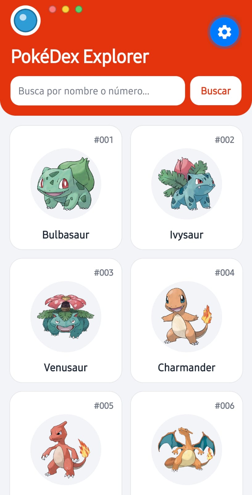
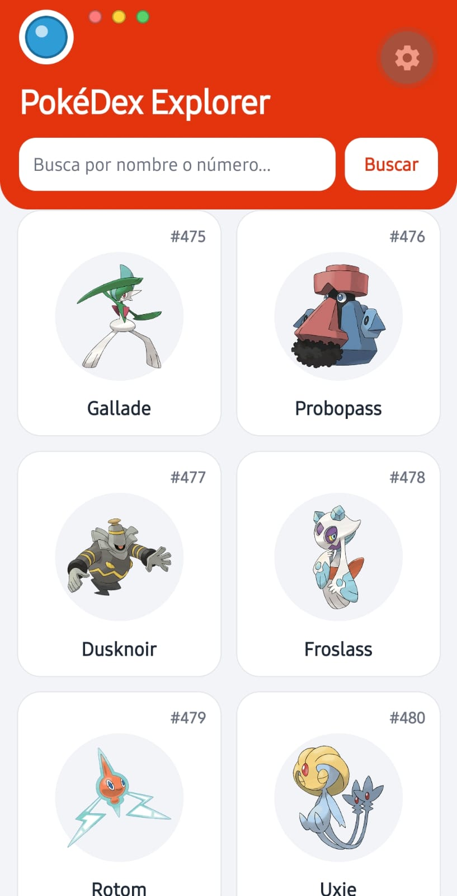
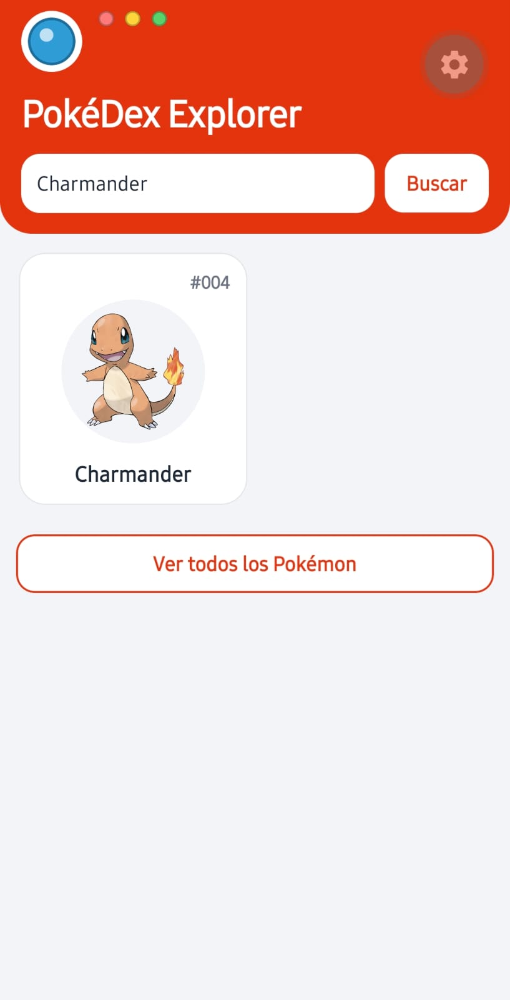
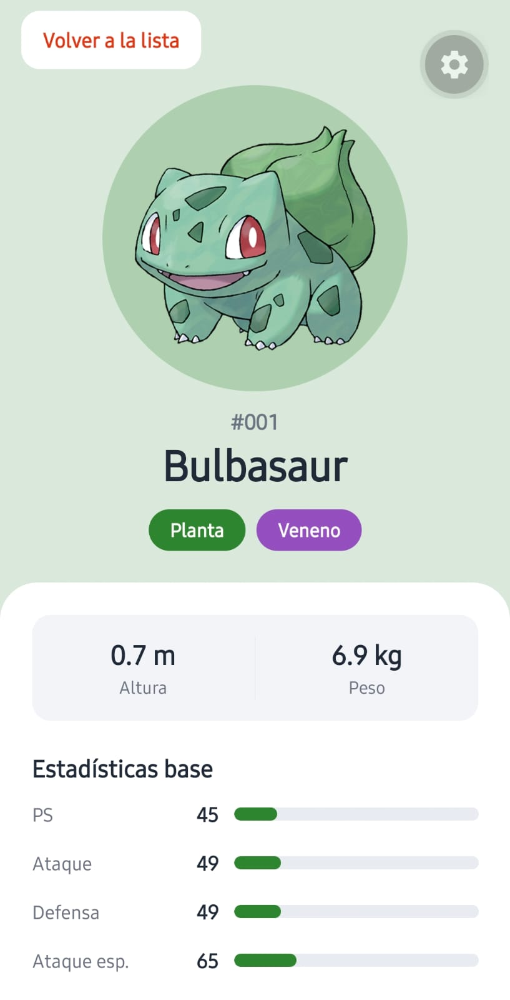
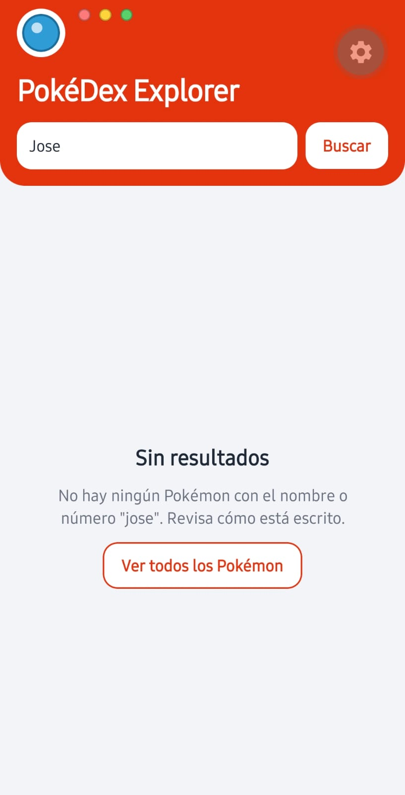
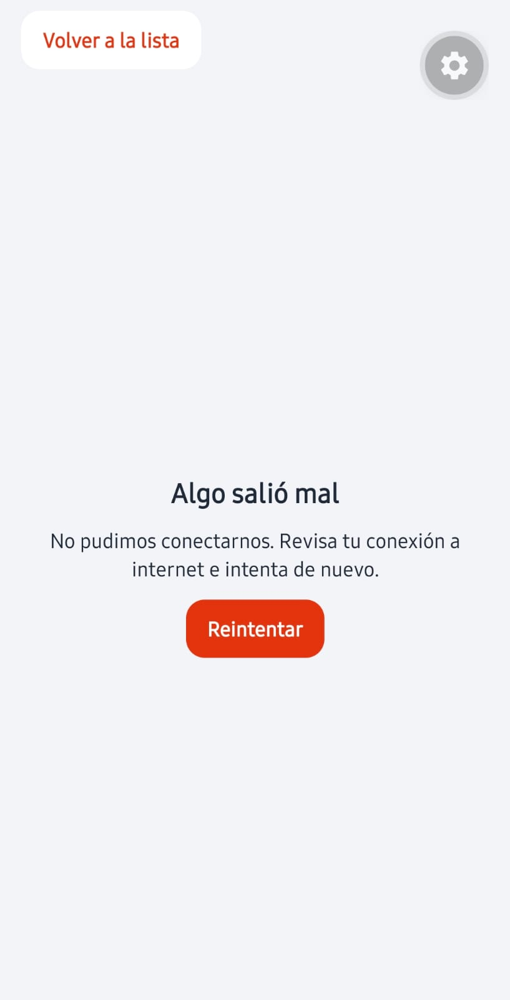

# PokéDex Explorer

App móvil hecha con **React Native + Expo** que consume la [PokéAPI](https://pokeapi.co/): lista los Pokémon con scroll infinito, permite buscarlos por nombre o número y muestra su ficha con imagen, tipos, medidas y estadísticas.

| | |
|---|---|
| **Taller** | Consumo de API con React Native y Expo — PokéDex |
| **Materia** | Desarrollo Móvil — Tecnológico de Antioquia |
| **Docente** | Paula Andrea |
| **Integrante** | Jose Alejandro Colorado Ruiz (trabajo individual) |
| **Tecnologías** | React Native 0.88, Expo SDK 58 (plantilla *blank*), JavaScript, `fetch` |

## Cómo ejecutarlo

```bash
git clone https://github.com/josealejandrocr2001/pokedex-explorer.git
cd pokedex-explorer
npm install
npx expo start
```

Escanea el QR con **Expo Go**, o presiona `a` (emulador Android) o `i` (simulador iOS). No hace falta ninguna librería HTTP: `fetch` viene incluido.

## Qué hace la app

**Vista de lista**
- [x] Encabezado con el título "PokéDex Explorer".
- [x] Búsqueda por nombre o número (`TextInput` + botón "Buscar"); ignora mayúsculas y espacios al inicio o al final. También acepta `#025` o `025`.
- [x] Cuadrícula de 2 columnas: imagen, número con 3 dígitos (`#025`) y nombre con mayúscula inicial.
- [x] Carga 20 Pokémon al abrir y 20 más al llegar al final (scroll infinito), con indicador al final de la lista.
- [x] Tocar una tarjeta abre la ficha.

**Vista de detalle**
- [x] Imagen grande, nombre y número.
- [x] Un distintivo por tipo con color propio (paleta propia en `src/constants/pokemon.js`).
- [x] Altura en metros y peso en kilogramos (la API los entrega en decímetros y hectogramos).
- [x] Las 6 estadísticas base con valor y barra proporcional al máximo (255).
- [x] Botón "Volver a la lista" (y el botón atrás de Android hace lo mismo).

**Estados de la interfaz:** toda petición muestra en qué estado está.

| Estado | Lista | Búsqueda | Ficha |
|---|---|---|---|
| Cargando | Indicador + "Cargando Pokémon..." (y "Cargando más Pokémon..." al final) | "Buscando Pokémon..." | "Cargando ficha..." |
| Error | Mensaje en español + "Reintentar" | Mensaje + "Reintentar" | Mensaje + "Reintentar" |
| Sin resultados | — | "Sin resultados" + "Ver todos los Pokémon" | — |
| Éxito | La cuadrícula | La tarjeta encontrada | La ficha |

## Arquitectura

La única regla del taller era que las llamadas a la API no quedaran mezcladas con los estilos y el JSX. Por eso el código se organizó en **capas**, donde cada una solo habla con la de abajo:

```
 screens/        →   hooks/              →   services/            →   apiClient    →   PokéAPI
 qué se dibuja       estado + useEffect      arma la URL y mapea      fetch y          (JSON)
                     (cargando/error/éxito)  el JSON                  response.ok
```

### Árbol de carpetas

```
pokedex-explorer/
├── App.js                          # Raíz: SafeAreaProvider y estado que alterna lista ↔ ficha
├── index.js                        # Registro de la app (plantilla de Expo)
├── app.json                        # Configuración de Expo
├── assets/                         # Íconos y splash de la plantilla
└── src/
    ├── config/
    │   └── api.js                  # BASE_URL, PAGE_SIZE (20) y URL del arte oficial
    ├── services/
    │   ├── apiClient.js            # fetchJson: el ÚNICO fetch de la app; revisa response.ok y lanza errores
    │   └── pokemonService.js       # Endpoints de la PokéAPI y mapeo de solo los campos que se usan
    ├── hooks/
    │   ├── usePokemonList.js       # Estado de la lista paginada (scroll infinito)
    │   ├── usePokemonSearch.js     # Estado de la búsqueda (incluye "sin resultados")
    │   └── usePokemonDetail.js     # Estado de la ficha
    ├── screens/
    │   ├── PokemonListScreen.js    # Vista de lista: encabezado, búsqueda, cuadrícula y estados
    │   └── PokemonDetailScreen.js  # Vista de detalle: imagen, tipos, medidas y estadísticas
    ├── components/
    │   ├── AppHeader.js            # Encabezado rojo con SafeAreaView
    │   ├── SearchBar.js            # TextInput + botón "Buscar"
    │   ├── PokemonGrid.js          # FlatList de 2 columnas con onEndReached
    │   ├── PokemonCard.js          # Tarjeta: imagen, número y nombre
    │   ├── TypeBadge.js            # Distintivo de un tipo con su color
    │   ├── StatBar.js              # Barra proporcional de una estadística
    │   ├── StatusViews.js          # Estados reutilizables: cargando, error y vacío
    │   └── PrimaryButton.js        # Botón con estilo propio (Pressable)
    ├── constants/
    │   └── pokemon.js              # Paleta de tipos, nombres en español y máximo de stats (255)
    ├── utils/
    │   ├── formatters.js           # #025, mayúscula inicial, m/kg, limpieza del texto de búsqueda
    │   └── errorMessages.js        # Error técnico → mensaje claro en español
    └── theme/
        └── index.js                # Colores, espaciados y bordes
```

### Por qué se organizó así

1. **Separación de responsabilidades.** Cada capa tiene una sola razón para cambiar: si la PokéAPI cambia un campo, solo se toca `pokemonService.js`; si cambia el diseño, solo se tocan `components/` y `screens/`. Ninguna pantalla conoce una URL ni lee el JSON crudo.
2. **Un solo `fetch` (`apiClient.js`).** La regla "revisar `response.ok` antes de `response.json()`" se escribe una vez. Es importante porque un nombre inexistente responde **404 con texto plano**, no JSON; si se llamara `response.json()` directamente, la app fallaría con un error de parseo.
3. **Hooks para el estado.** Cada hook guarda los estados (`loading`, `error`, `success`...) y contiene el `useEffect` que hace la petición. Las pantallas solo deciden qué dibujar según el estado, así que se leen como la tabla de estados de arriba.
4. **Un solo archivo de servicio.** La app consume una sola API con dos endpoints, así que separarla en más archivos sería complejidad sin beneficio. Si se agrega otra fuente de datos (por ejemplo, favoritos en una base de datos), iría en su propio archivo dentro de `services/`.
5. **Componentes pequeños y reutilizables.** `PokemonGrid` se usa para la lista y para el resultado de la búsqueda; `StatusViews` se usa en las tres vistas.
6. **Sin librería de navegación.** El taller pide la plantilla *blank* con una pantalla y dos vistas, así que un `useState` en `App.js` decide qué vista se ve.

## Decisiones técnicas clave

- **Array de dependencias de `useEffect`.** Cada petición vive en un `useEffect` con dependencias explícitas: la lista con `[offset, retryCount]`, la búsqueda con `[query, retryCount]` y la ficha con `[pokemonId, retryCount]`. La petición solo se repite cuando cambia la página, el texto buscado, el Pokémon o cuando el usuario pulsa "Reintentar". Sin el array habría un bucle infinito: petición → `setState` → render → petición...
- **Cancelar peticiones con `AbortController` (`signal`).** La limpieza de cada efecto cancela la petición en curso. Si el usuario busca otra cosa o vuelve a la lista antes de que llegue la respuesta, no se muestra un resultado viejo ni se actualiza una pantalla que ya no existe.
- **Scroll infinito sin páginas repetidas.** El nuevo `offset` es la cantidad de Pokémon ya cargados (`pokemons.length`). Si `onEndReached` se dispara varias veces seguidas, siempre calcula el mismo valor y React no repite la petición. Además, no se pide otra página mientras una está cargando o falló.
- **404 en la búsqueda = "Sin resultados", no error.** `searchPokemon` convierte el 404 en `null`. Cualquier otro fallo (sin internet, 5xx) sí se muestra como error con "Reintentar".
- **`encodeURIComponent` solo para texto.** El nombre que escribe el usuario se codifica antes de ir en la URL; un id numérico no lo necesita.
- **Imágenes de la lista sin pedir la ficha.** La imagen se arma con el id (`.../official-artwork/{id}.png`), así cada página son 1 petición y no 21. Toda `Image` remota tiene `width` y `height` explícitos.
- **La lista no se desmonta al abrir la ficha**, solo se oculta (`display: 'none'`). Al volver se conservan los Pokémon cargados y la posición del scroll, sin repetir peticiones.
- **Rendimiento de la lista.** `FlatList` (no `ScrollView` + `map`) solo dibuja lo visible; `memo` en `PokemonCard` y `useCallback` en `renderItem` evitan re-renderizar las tarjetas que ya estaban.

## Capturas

| Lista | Cargando más | Búsqueda | Ficha |
|---|---|---|---|
|  |  |  |  |

| Sin resultados | Error |
|---|---|
|  |  |

## Desarrollo por partes (commits)

1. `chore`: proyecto Expo (plantilla *blank*) y estructura de carpetas.
2. `feat(api)`: capa de servicios para consumir la PokéAPI.
3. `feat(lista)`: vista de lista con `FlatList`, scroll infinito y estados.
4. `feat(busqueda-detalle)`: búsqueda por nombre o número y ficha del Pokémon.
5. `docs`: este README, arquitectura y bitácora de uso de IA.

El uso de herramientas de IA en el taller está documentado en [`BITACORA_IA.md`](BITACORA_IA.md).
